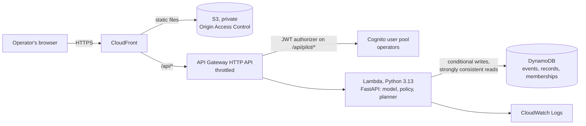

# ProofPlate

**Serve a better first portion, keep seconds available, and show what actually changed.**

ProofPlate is a serving-counter and kitchen tool for a college mess. It learns how much of a dish each diner usually chooses to eat, suggests the first portion, records seconds and leftovers, and turns that into the kitchen's preparation and reserve plan.

Built for Environmental Hacks (AWS × WeMakeDevs, Bharat Builds Tour), Waste and Energy track, 11 October 2026.

## The idea in one picture

An empty plate is ambiguous. The diner may have had enough, or may still be hungry. A scale cannot tell.

| What the diner says | What the model may conclude |
|---|---|
| "That was enough." | Appetite was *about* this much |
| "I wanted more." | Appetite was *at least* this much |
| Nobody asked | Nothing. The plate is recorded but not used |

A system that treats every empty plate as "that amount was right" keeps under-serving the hungry diner. ProofPlate uses a censored likelihood so "wanted more" can only move an estimate up. The Learn page shows this live, on the real model.

## What is real and what is not

| | Status |
|---|---|
| Software | Implemented and tested. See "Verification" below |
| AWS deployment | Live at https://imh92ymqaa.execute-api.ap-south-1.amazonaws.com (Lambda, API Gateway, DynamoDB, Cognito; CloudFront pending account verification). See `DEPLOYMENT.md` |
| Field evidence | **None collected.** No real kitchen has been measured. Every result in this repository is simulated and labelled so |

## What it does

- **Serve** — enter a diner token, see the suggested first portion with its likely range and the reason, let the diner choose differently, record seconds and the plate return.
- **Learn** — one diner's plates, how each was used, how the estimate moved, and "same empty plate, different evidence".
- **Kitchen** — how much to cook before service, how much to hold in reserve, when to start each batch, the modelled chance of running short, and a clear *infeasible* state when stock or refill capacity cannot meet the plan.
- **Evidence** — observed, predicted and simulated results kept apart, each with its sample size; CSV/JSON export; a print view.
- **Leftovers from two photos** — in the return form, add a photo of the plate as served and one as returned. A segmentation model in the browser outlines the plate and the food, either outline can be corrected by tapping or brushing, and the result is saved as a labelled `photo_estimate` with its uncertainty. Photos are not uploaded.
- **Setup** — scoop calibration, meal services, diner tokens (with export and deletion), and validated CSV import.

Two workspaces that cannot touch each other:

- **Demo** (public): fixed simulated seed data. Your entries live only in your browser; the server recomputes from them and stores nothing.
- **Pilot** (sign-in): starts empty. Records are durable in DynamoDB and scoped to the operator's site.

## Architecture



- The web app and the API share one origin, so the browser needs no API URL and no CORS.
- Runtime settings (Cognito ids, region) come from `/api/config`, which reads the deployed stack's own values.
- No always-on compute, no NAT gateway, no GPU, no LLM.

Code layout:

```
apps/web/                 React + TypeScript + Vite; hand-built SVG charts
services/api/proofplate/
  numerics.py             stable normal CDF in NumPy (no SciPy at runtime)
  model/                  censored lognormal grid posterior, baselines
  planning/               first-portion policy, kitchen planner
  domain/                 schemas, mass-balance rules, plate → evidence
  repositories/           memory, SQLite, DynamoDB adapters (one contract)
  service.py, transfer.py use cases, import/export
  main.py                 HTTP surface (demo and pilot)
evaluation/               simulator, policy comparison, frontier sweep
infra/template.yaml       AWS SAM template
scripts/                  build, deploy, local run, operator invite, demo seed
tests/                    pytest suite + browser walkthrough
```

## Run it locally

Needs Python 3.12+ and Node 20+.

```powershell
pip install fastapi==0.115.0 pydantic==2.11.5 mangum==0.19.0 numpy==2.3.2 uvicorn
cd apps\web; npm ci; npm run build; cd ..\..
powershell -ExecutionPolicy Bypass -File scripts\dev.ps1 -Seed
```

Open http://127.0.0.1:8000. The demo needs no sign-in. For the pilot workspace, sign in with the development user `manager`. This development sign-in only exists when `PROOFPLATE_ENV=local`; a deployed stack refuses to start with it.

## Tests

```powershell
pip install pytest scipy httpx "moto[dynamodb]" boto3 playwright
python -m pytest tests                                  # model, policy, rules, API, storage adapters
python tests\e2e\walkthrough.py http://127.0.0.1:8000   # full browser flow, desktop and phone
```

## Reproduce the simulated evaluation

```powershell
python scripts\make_demo_seed.py
python scripts\make_sample_photos.py   # generated demo photos for the photo estimate
python -m evaluation.run_evaluation
python -m evaluation.run_frontier
```

Outputs: `evaluation/outputs/evaluation.json` and `EVALUATION.md`. The Evidence page reads the same JSON.

## Keeping the web client and API in step

Request types in the web app are generated from the API's OpenAPI schema, so a renamed field fails the type-check.

```powershell
$env:PYTHONPATH = "services/api"; $env:PROOFPLATE_STORE = "memory"
python -c "import json; from proofplate.main import app; open('apps/web/openapi.json', 'w').write(json.dumps(app.openapi()))"
cd apps\web; npm run gen:api
```

## Deploy to AWS

Needs AWS CLI v2 with an active session (`aws login`). No Docker.

```powershell
powershell -ExecutionPolicy Bypass -File scripts\deploy.ps1
powershell -ExecutionPolicy Bypass -File scripts\create_operator.ps1 -Email you@example.org -Site hostel-4 -Role manager
```

Details, costs, verification and teardown: `DEPLOYMENT.md`.

## Documents

| File | What it covers |
|---|---|
| `MODEL_CARD.md` | What is estimated, how plates become evidence, priors, policy, limits |
| `EVALUATION.md` | Simulated policy comparison and frontier, with intervals |
| `DATA_MANIFEST.md` | Every dataset and its provenance; retention and deletion |
| `DEPLOYMENT.md` | Live URLs, resources, cost, verification, rollback, teardown |
| `docs/STATION_SHEET.md` | Printable sheet for recording a meal service |
| `blogs/` | Technical write-ups about the model, photo estimate and deployment |

## Boundaries

- Not a diet, calorie or medical tool. "Demand" means what a diner chooses to eat with seconds available.
- A suggestion never overrides a diner's request, and seconds stay available.
- No names, faces, body measurements or health data. Tokens can be exported and deleted.
- No calories, CO₂, money or "meals saved" figures: the unit is weighed edible grams.
- "Chance of running short" is modelled under stated assumptions. It is not a guarantee.

## Acknowledgements and licenses

- Runtime libraries: FastAPI (MIT), Pydantic (MIT), Mangum (MIT), NumPy (BSD-3-Clause), React (MIT), Vite (MIT).
- The complementary error function fit is the `erfcc` approximation from *Numerical Recipes*; it is verified against SciPy in the tests.
- All diagrams, icons and plate graphics are original SVG. No photographs or third-party images are used.
- Photo estimate, fetched by the browser at first use and not bundled: [Transformers.js](https://github.com/huggingface/transformers.js) (Apache-2.0) from jsDelivr, ONNX Runtime Web (MIT), and the [SlimSAM](https://huggingface.co/Xenova/slimsam-77-uniform) weights (Apache-2.0, derived from Meta's Segment Anything) from the Hugging Face Hub.
- Claude Code (Anthropic) assisted with application implementation, tests, the AWS infrastructure template, and documentation. The team specified the product, directed and reviewed the work, and checked the reported behaviour and results. The optional photo estimate uses SlimSAM through Transformers.js in the browser; that is a runtime model used by the product.
